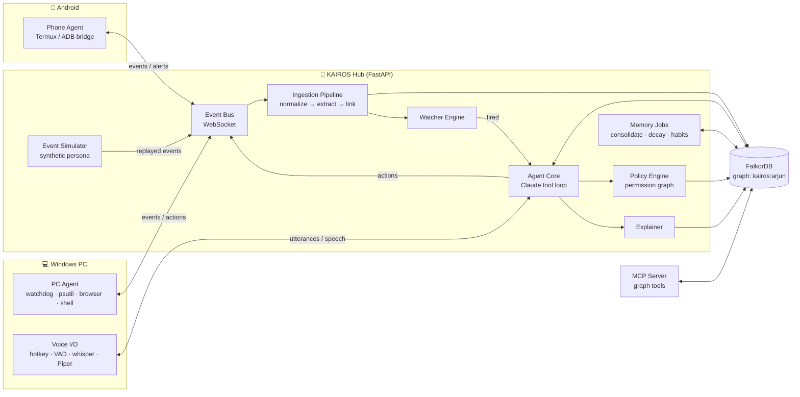
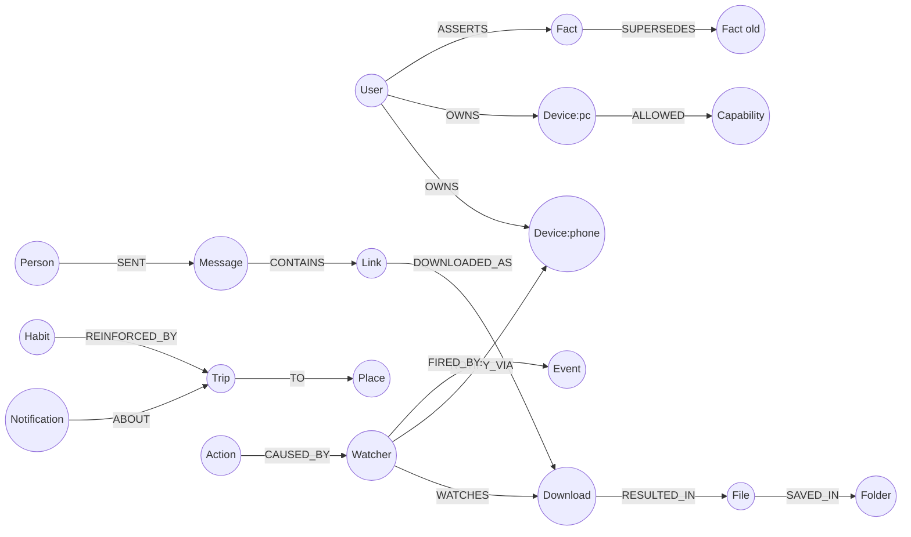

# Project KAIROS — Technical Design Document
**A voice-first, cross-device personal agent whose memory is a graph**
Graph Hacks: Context for AI Agents (WeMakeDevs × FalkorDB) · Oct 15–18, 2026
Tracks entered: **Track 02 — Agent Memory and Coordination** (primary), **Track 01 — Agents That Act on Connected Data** (secondary)

> Working name "KAIROS" (Greek: *the right moment*): the assistant acts at the right moment because it knows how events connect. Rename freely.

## The idea

Today's assistants forget what you told them yesterday, and each one is stuck on a single device. Your phone knows your Uber is arriving, your PC knows your download just finished, but nothing connects the two or remembers how they relate. **KAIROS is a voice-controlled personal assistant, in the spirit of Jarvis, that lives across your Android phone and Windows PC at once.** You talk to it naturally: *"Tell me when the download finishes," "Remind me when my Uber is two minutes away," "What was that PDF Rahul sent me yesterday? Open it."* It reads notifications, watches files, downloads and the browser, and can run terminal commands, asking first before anything risky. Its brain is a **graph memory**: every event, person, file, place and habit becomes a connected node, so it remembers across sessions, learns your routines over time, shares context between the phone and the PC, and can always explain *why* it did something by showing the chain of events behind it. The long-term vision is a dedicated hardware companion. For this hackathon, the goal is a working software prototype that proves a graph-based memory makes an assistant feel like a real companion.

### Core vision
| Piece of the idea | What it means in KAIROS |
|---|---|
| **Voice first** | You control it by speaking and it answers out loud. Push-to-talk for the prototype, an always-listening wake word later. |
| **Phone + PC, terminal-level access** | One assistant spanning your **Android phone** and **Windows PC**. It can run commands on both: PowerShell on the PC, Termux shell on the phone. Risky actions need your spoken "yes". |
| **Sees what you see** | Reads phone notifications, watches files and folders, tracks downloads, and knows which pages you've visited in the browser. |
| **"Tell me when…" commands** | *"Tell me when the download is finished."* *"Remind me when the Uber is coming."* It keeps waiting in the background and alerts you on whichever device you're using. |
| **Jarvis-style companion** | Not a command runner but an assistant that knows your context, your people and your routines, and talks to you like it does. |
| **Memory is the core** | Everything goes into a graph. It remembers across sessions, updates what it knows when things change, and **evolves with you** the longer you use it. |
| **Hardware in the long term** | A dedicated device (for example a desk speaker or wearable with a mic array) that becomes one more device connected to the same brain. |

### Going further: what the graph memory makes possible
- **Find anything by how you remember it:** *"That file from the email Rahul sent last week"*, *"the site I was reading before the meeting"*. It follows connections instead of searching by keyword.
- **Learns your routines:** notices you book an Uber to the office around 9 on weekdays, then offers to remind you or prepare things ahead of time.
- **Proactive nudges:** *"Your download finished and Rahul is asking about that report. Want me to open it?"* It joins events from different devices and apps.
- **Cross-device handoff:** start on the phone, finish on the PC. *"Open the link I just got on WhatsApp on my laptop."* *"Send this file to my phone."*
- **Picks up where you left off:** *"What was I working on yesterday evening?"* rebuilds your session from files, browser and commands.
- **Daily briefing:** a morning or evening voice summary of what happened, what's pending and what's coming up.
- **Knows your people:** who Rahul is to you, what you last talked about, what's still open with them.
- **Explains itself:** *"Why did you remind me?"* It shows the chain of events behind every action, so you can trust it and correct it.
- **Remembers and forgets on request:** *"Remember that my office moved to Cyber City"*, *"Forget everything about that trip."* You stay in control of your memory.
- **Safe by design:** a permission map decides what it can do on its own, what it must ask about, and what it can never do. Every action is logged.

## Why we're building this for Graph Hacks

**Graph Hacks: Context for AI Agents** (WeMakeDevs × FalkorDB, online, Oct 15–18, 2026) asks builders to create AI agents that use **FalkorDB as their context layer**. The graph has to shape what the agent does, not sit alongside it. The hackathon's central idea is that *agents are only as good as their context*: they lose track of earlier sessions, miss how people, systems and records relate, and can't explain their choices. A personal assistant hits all three problems every day, which makes KAIROS a natural fit.

**Hackathon tracks**
| Track | Focus | How KAIROS fits |
|---|---|---|
| **01 — Agents That Act on Connected Data** | Reasoning across several hops, graph queries and algorithms as agent tools, tool selection through MCP, actions driven by the graph, explainable results | Watchers fire actions from graph matches. Recall walks Person → Message → Link → Download → File. Graph tools are exposed over MCP. "Why?" returns the path. |
| **02 — Agent Memory and Coordination** *(primary)* | Episodic, semantic and procedural memory; persistent history; shared state and handoffs between agents; concurrent reads and writes; separate memory per user | Core of the product: three memory types, facts that change over time, habits that strengthen, phone and PC agents coordinating through one graph, one graph per user. |
| 03 — Company Brain | One graph of people, teams, projects, docs and decisions | Not targeted. |

**What the hackathon emphasizes, and how we answer it**
- **The graph must be essential.** In KAIROS, recall, watchers, habits, permissions and explanations are all graph queries. Remove FalkorDB and the product stops working.
- **Memory that persists and evolves.** Facts are versioned instead of overwritten, and habits grow or fade with use.
- **Coordination between agents.** The phone and PC agents share state and hand off tasks through the graph.
- **Explainability.** Every action traces back to the events that caused it.
- **Working, demonstrable product.** Open-source repo, documented graph model and Cypher queries, and a demo video. Demos use a synthetic persona ("Arjun Mehta") rather than real personal data.

---

## Fixed vs. flexible

**Fixed (the product vision, not up for negotiation):**
1. Voice-first assistant that spans **phone + PC** as one brain.
2. **FalkorDB is the brain**: recall, watchers, habits, permissions and explanations are graph queries. No graph means no product.
3. **"Tell me when…"** watchers that fire across devices.
4. **Memory that evolves**: facts are versioned (never overwritten), habits strengthen and decay.
5. **Explains itself**: every action traces back to the events that caused it.
6. **Safe by design**: permission graph; risky actions always ask first.

**Flexible (change freely if something is easier or breaks):** libraries, the LLM provider and models, STT/TTS engines, the phone transport (Termux / ADB / app), the UI, exact property names, query shapes, and which stretch features make the cut.

**LLM status:** the agent talks to the LLM through `kairos/agent/llm.py`. The LLM is any tool-calling model via **OpenRouter** (key and model in `.env`). A **rule-based planner is the offline backup**: no internet, no key, or an API error, and KAIROS keeps working. Yes/no confirmations are always decided by rules.

---

## 0. TL;DR

KAIROS is a Jarvis-style assistant that runs across an **Android phone** and a **Windows PC**. It listens by voice, watches device events (notifications, downloads, files, browser, commands), and stores everything as a **temporal knowledge graph in FalkorDB**. The graph is the product's brain:

- **Memory:** episodic (what happened), semantic (facts about people, places, preferences), procedural (habits, how the user likes things done). Facts are versioned over time, never silently overwritten.
- **Watchers:** "Tell me when X" requests are stored as graph patterns, matched against every new event.
- **Coordination:** the PC agent and phone agent are separate agents that share state and hand off tasks through the graph.
- **Permissions:** what the agent may do autonomously is itself a graph (capability → device → risk tier).
- **Explainability:** every action can answer *"why did you do that?"* by returning the graph path that caused it.

**Graph test:** if you remove FalkorDB, recall, watchers, habits, permissions and explanations all stop working. The graph is load-bearing, not decoration.

---

## 1. Goals and non-goals

### 1.1 Goals (hackathon scope)
| # | Capability | Demo line |
|---|---|---|
| G1 | Voice in / voice out (push-to-talk) | "Hey Kairos…" (hotkey) |
| G2 | Ingest phone notifications + PC events into one graph | Live event stream visible in FalkorDB Browser |
| G3 | Cross-device recall via multi-hop queries | "What was that PDF Rahul sent me yesterday? Open it." |
| G4 | Watchers / conditional triggers | "Tell me when the download finishes." / "Remind me when my Uber is 2 minutes away." |
| G5 | Evolving memory (facts superseded, habits strengthened) | "I moved to the Cyber City office." → future answers change, history kept |
| G6 | Agent coordination (phone ↔ PC handoff) | PC finishes download → phone vibrates |
| G7 | Explainability | "Why did you remind me?" → path shown |
| G8 | Permission graph + confirmations | "Delete my temp folder" → asks before acting |

### 1.2 Non-goals (for Oct 15–18)
- Custom hardware (future-work slide only — see §16).
- Always-on wake word (stretch).
- Full phone control (tapping UI, booking Uber). Read + notify only.
- Polished GUI. Terminal UI + FalkorDB Browser + optional tiny web dashboard.


---

## 2. Technology choices

### 2.1 Summary
| Layer | Choice | Why |
|---|---|---|
| Core language | **Python 3.12** | Best ecosystem for FalkorDB client, LLM SDKs, speech (faster-whisper, Piper), Windows automation, Termux. One language across hub, PC agent and phone agent. |
| Graph DB | **FalkorDB** (Docker `falkordb/falkordb:latest`) | Required. Low-latency traversals on every agent step; multigraph = one graph per user; built-in vector + full-text indexes and graph algorithms. |
| DB client | `falkordb` (official Python client) | Native, async support. |
| Hub / API | **FastAPI + WebSockets** (uvicorn) | Device agents push events over WS; agent pushes notifications back. Simple, async. |
| Data contracts | **Pydantic v2** | One event envelope schema shared by every component. |
| LLM | **OpenRouter** (OpenAI-compatible API over `httpx`): a strong tool-calling model for the agent loop and an optional cheaper model for notification extraction; **rule-based planner as offline fallback** | Swap models without code changes; works with no internet. |
| UI | **Web dashboard** served by the hub (vanilla JS, built-in force-directed graph view, no CDN) | Live demo surface; works offline. |
| Embeddings | Local `sentence-transformers` (e.g. `bge-small-en-v1.5`, 384-d) | Offline, free, fast enough on CPU; stored in FalkorDB vector index. |
| Scheduler | **APScheduler** | Time-based watchers ("remind me at 6"), habit consolidation jobs. |
| Speech-to-text | **faster-whisper** (`small` or `base.en`, int8, CPU) + **Silero VAD** | Local, ~1 s latency for short commands. |
| Text-to-speech | **Piper** (offline) — fallback `edge-tts` | Local, natural, fast. |
| Hotkey / audio | `keyboard` (push-to-talk), `sounddevice` | Simple on Windows. |
| PC sensing | `watchdog` (filesystem), `psutil` (processes), browser history SQLite (copied read-only), `subprocess` (PowerShell) | No admin rights needed. |
| PC notifications out | `win11toast` | Native Windows toasts. |
| Android sensing (MVP) | **ADB over Wi-Fi from the PC** (`adb shell dumpsys notification --noredact`) — *or* **Termux + Termux:API** (`termux-notification-list`) | No app to build. ADB is zero-install on phone (just developer mode). |
| Android (stretch) | Kotlin companion app w/ `NotificationListenerService` | Real-time push, proper long-term path. |
| Phone notifications out | Termux:API `termux-notification` / `termux-vibrate`, or ntfy.sh self-hosted | Phone-side alerts. |
| Agent tool protocol | **MCP server** (`mcp` Python SDK, FastMCP) exposing graph tools | Track 01 explicitly lists "tool selection through MCP"; also lets Claude Desktop / Claude Code drive KAIROS. |
| UI | `rich`/`textual` TUI + FalkorDB Browser; optional FastAPI-served page with `vis-network` | Minimal effort, good demo visuals. |
| Packaging | **docker-compose** (falkordb + hub + mcp); device agents run natively | One-command local setup. |

### 2.2 Key decision: custom schema vs. Graphiti
| Option | Pros | Cons |
|---|---|---|
| **A. Custom typed schema (recommended)** | Full control, every Cypher query is yours and explainable; typed device events, watchers, permissions fit naturally | You implement temporal versioning yourself (simple: `valid_from/valid_to` on Fact edges) |
| B. Graphiti (`graphiti-core[falkordb]`) | Bi-temporal memory + entity resolution out of the box | Generic `Entity`/`RELATES_TO` model; harder to express watchers/permissions; judges may see it as "library did the work" |

**Decision:** A as the backbone. Optionally use Graphiti only for free-form conversation memory, linked into the same graph — only if time allows.

### 2.3 Why not Node/TypeScript or Kotlin for the core?
Speech (faster-whisper, Piper), Termux scripting and the Windows automation libraries are strongest in Python. Kotlin is reserved for the optional Android companion app.

---

## 3. System architecture

### 3.1 Component diagram


### 3.2 Runtime flows

**Flow A — event ingestion (every notification / file / command)**
1. Device agent captures raw event → wraps in `EventEnvelope` (§5) → sends over WS.
2. Ingestion: dedupe (hash of device+source+timestamp+text) → classify (Haiku; rules first, LLM only when rules don't match) → extract entities (people, places, files, links, trips, ETAs) → embed text.
3. Single Cypher transaction `MERGE`s the event node and links entities (Q1).
4. Event id is passed to the Watcher Engine → matching watchers fire (Q4).

**Flow B — voice command**
1. Push-to-talk → VAD-trimmed audio → faster-whisper → text.
2. Utterance stored as `(:Utterance)` event (episodic memory).
3. Context assembly (GraphRAG, §7.3): recent events + vector-nearest facts + 2-hop neighborhood of mentioned entities + active watchers + relevant habits.
4. Claude (Sonnet) tool loop with graph tools (§7.2). Any side-effecting tool passes the Policy Engine first.
5. Response → Piper TTS. Every action stored as `(:Action)` with `CAUSED_BY` edges → explainability.

**Flow C — watcher**
1. "Tell me when the download finishes" → agent calls `create_watcher` → `(:Watcher)` node with a structured condition linked to the target entity (e.g. the in-progress `(:Download)`).
2. On each new event, Watcher Engine runs Q4; matches → `(:Watcher)-[:FIRED_BY]->(:Event)`, agent composes alert, routes to the user's preferred device (Q7).
3. One-shot watchers set `status='done'`; recurring stay `active`.

**Flow D — coordination / handoff**
PC agent emits `download.completed` → watcher created by a *phone-originated* voice command fires → alert routed to phone. Both agents only ever talk through the graph + bus; the graph holds the shared state (`(:Task)-[:ASSIGNED_TO]->(:Device)`, `(:Handoff)` nodes).

**Flow E — memory consolidation (APScheduler, every N min + nightly)**
- Detect repeated patterns → create/strengthen `(:Habit)` (Q6).
- Decay `strength` of facts/habits not reinforced recently.
- Supersede contradicted facts (Q5).
- Optional: run community detection to cluster routines / people groups.

---

## 4. Graph data model

### 4.1 Multigraph layout
- One FalkorDB graph per user: `kairos:<user_id>` (demo: `kairos:arjun`). FalkorDB multigraph = per-tenant isolation in one instance (a Track 02 focus area).
- Optional `kairos:_system` graph for global capability definitions.

### 4.2 Node labels
| Label | Key properties | Memory type |
|---|---|---|
| `User` | `id, name, tz` | — |
| `Device` | `id, kind (phone/pc), name, online, last_seen` | — |
| `App` | `package/name, category` | semantic |
| `Event` (+ sub-label) | `id, type, ts, source, text, hash, status?, embedding` | **episodic (immutable)** |
| ↳ `Notification` | `app, title, body, priority` | episodic |
| ↳ `DownloadEvent` | `status (in_progress/completed/failed)`; `-[:UPDATES]->(Download)` | episodic |
| `Download` | `id, url, filename, status, bytes` — **mutable entity**; its state changes are recorded as immutable `DownloadEvent`s | semantic |
| ↳ `FileEvent` | `op (created/modified/moved/deleted), path` | episodic |
| ↳ `BrowserVisit` | `url, title, browser` | episodic |
| ↳ `CommandRun` | `cmd, exit_code, stdout_excerpt` | episodic |
| ↳ `Utterance` | `text, speaker (user/agent), session_id` | episodic |
| `Person` | `id, name, aliases[], embedding` | semantic |
| `Place` | `id, name, kind (home/office/…), geo?` | semantic |
| `File` | `path, name, ext, size, hash` | semantic |
| `Folder` | `path` | semantic |
| `Message` | `channel (email/whatsapp/sms), subject, snippet` | episodic |
| `Link` | `url, domain` | semantic |
| `Trip` | `id, provider, status, eta_min, driver, ts, weekday, hour` | episodic |
| `Fact` | `id, key, statement, embedding, confidence, strength, valid_from, valid_to, archived` | **semantic (versioned)** |
| `Habit` | `id, pattern, schedule (cron-like), strength, last_reinforced, count` | **procedural** |
| `Preference` | `key, value, valid_from, valid_to` | procedural |
| `Watcher` | `id, description, condition_type (entity_state/event_type/trip_eta/app_text/time), target_status?, event_type?, provider?, eta_threshold?, app?, keyword?, due_ts?, mode (once/recurring), status, created_at` | procedural / coordination |
| `Task` | `id, title, status, due` | coordination |
| `Action` | `id, tool, args_json, result, ts, status (pending_confirmation/done/denied/cancelled/failed)` | audit / explainability |
| `Capability` | `name (e.g. shell.exec, file.delete, notify), risk (0–3)` | policy |
| `Session` | `id, started, ended, device` | episodic |

### 4.3 Relationship types
| Edge | From → To | Notes |
|---|---|---|
| `OWNS` | User → Device | |
| `ON_DEVICE` | Event → Device | |
| `FROM_APP` | Notification → App | |
| `MENTIONS` | Event → Person/Place/File/Link/Trip | produced by extraction |
| `SENT` / `RECEIVED` | Person → Message / Message → User | |
| `CONTAINS` | Message → Link · Folder → File | |
| `DOWNLOADED_AS` | Link → Download → File (`RESULTED_IN`) | cross-device chain |
| `UPDATES` | DownloadEvent → Download | state change of a mutable entity |
| `SAVED_IN` | File → Folder | |
| `ABOUT` | Notification → Trip | |
| `TO` / `FROM` | Trip → Place | |
| `NEXT` | Event → Event | per-device timeline (cheap temporal traversal) |
| `IN_SESSION` | Utterance → Session | |
| `KNOWS` / `WORKS_WITH` / `RELATION {type}` | Person → Person / User → Person | |
| `ASSERTS` | User → Fact | `{valid_from, valid_to}` |
| `ABOUT_ENTITY` | Fact → Person/Place/App/… | |
| `SUPERSEDES` | Fact → Fact | memory evolution, never delete |
| `DERIVED_FROM` | Fact/Habit → Event | provenance |
| `REINFORCED_BY` | Habit → Event/Trip | |
| `WATCHES` | Watcher → entity (Download/Trip/App/Person) | |
| `CREATED_BY` | Watcher/Task → Utterance | |
| `FIRED_BY` | Watcher → Event | |
| `NOTIFY_VIA` | Watcher → Device | |
| `CAUSED_BY` | Action → Event/Watcher/Utterance/Habit | explainability backbone |
| `USED_CAPABILITY` | Action → Capability | |
| `ALLOWED` | Device → Capability `{mode: auto/confirm/deny}` | permission graph |
| `ASSIGNED_TO` | Task → Device | coordination |
| `HANDED_OFF` | Device → Device `{task_id, ts}` | coordination |

### 4.4 Schema diagram (for README)


### 4.5 Temporal model
- **Events** are immutable, timestamped (`ts`, epoch ms) and chained with `NEXT` per device.
- **Facts / Preferences** carry `valid_from` / `valid_to` (`valid_to = null` = currently true). A contradiction creates a new Fact and closes the old one + `SUPERSEDES` edge. History is queryable ("where did I work last month?").
- **Habits** carry `strength ∈ [0,1]`: reinforced `+α(1-s)` on matching event, decayed `s·e^(-λΔt)` nightly; pruned below threshold.

### 4.6 Indexes
```cypher
CREATE INDEX FOR (e:Event) ON (e.ts)
CREATE INDEX FOR (e:Event) ON (e.hash)
CREATE INDEX FOR (p:Person) ON (p.name)
CREATE INDEX FOR (f:File) ON (f.path)
CREATE INDEX FOR (w:Watcher) ON (w.status)
CREATE INDEX FOR (d:Download) ON (d.status)
CALL db.idx.fulltext.createNodeIndex('Event', 'text')
CALL db.idx.fulltext.createNodeIndex('Person', 'name')
CREATE VECTOR INDEX FOR (f:Fact) ON (f.embedding) OPTIONS {dimension: 384, similarityFunction: 'cosine'}
CREATE VECTOR INDEX FOR (e:Event) ON (e.embedding) OPTIONS {dimension: 384, similarityFunction: 'cosine'}
```
*(Verify exact index syntax against the FalkorDB docs version you run.)*

---

## 5. Event contract

Every device agent and the simulator emit the same envelope (Pydantic model `EventEnvelope`):

```json
{
  "event_id": "uuid",
  "user_id": "arjun",
  "device_id": "pc-main",
  "type": "notification | download.started | download.completed | file.created | browser.visit | command.run | utterance",
  "ts": 1760000000000,
  "source": "com.ubercab | chrome | explorer | shell | voice",
  "payload": { "title": "...", "body": "...", "path": "...", "url": "..." },
  "raw": { }
}
```

Outbound (hub → device):
```json
{ "kind": "alert | speak | exec | open", "device_id": "phone-arjun", "text": "...", "args": { }, "action_id": "uuid", "requires_confirmation": false }
```

---

## 6. Core Cypher queries (the ones the product depends on)

> Keep these in `queries/*.cypher` from day 1 — they are part of the submission. Parameters use `$name`.

**Q1 — Ingest a notification and link entities**
```cypher
MATCH (d:Device {id: $device_id})
MERGE (app:App {name: $app})
CREATE (n:Event:Notification {id: $id, ts: $ts, source: $app, title: $title,
                              text: $body, hash: $hash, embedding: vecf32($emb)})
CREATE (n)-[:ON_DEVICE]->(d), (n)-[:FROM_APP]->(app)
WITH n, d
OPTIONAL MATCH (d)<-[:ON_DEVICE]-(prev:Event) WHERE prev.ts < n.ts AND NOT (prev)-[:NEXT]->()
FOREACH (_ IN CASE WHEN prev IS NULL THEN [] ELSE [1] END | CREATE (prev)-[:NEXT]->(n))
WITH n
UNWIND $people AS pname
  MERGE (p:Person {name: pname})
  CREATE (n)-[:MENTIONS]->(p)
```

**Q2 — Cross-device recall: "the PDF Rahul sent me yesterday"**
```cypher
MATCH (p:Person)-[:SENT]->(m:Message)-[:CONTAINS]->(l:Link)
      -[:DOWNLOADED_AS]->(dl:Download)-[:RESULTED_IN]->(f:File)
WHERE toLower(p.name) CONTAINS toLower($person)
  AND f.ext = $ext
  AND m.ts >= $since
RETURN f.path AS path, f.name AS name, m.subject AS subject, m.ts AS sent_at,
       [p.name, m.subject, l.url, dl.filename, f.path] AS evidence_path
ORDER BY m.ts DESC LIMIT 3
```

**Q3 — Semantic memory recall (vector) + graph expansion (GraphRAG)**
```cypher
CALL db.idx.vector.queryNodes('Fact', 'embedding', 8, vecf32($q_emb)) YIELD node AS f, score
WHERE f.valid_to IS NULL
OPTIONAL MATCH (f)-[:ABOUT_ENTITY]->(x)-[r]-(y)
RETURN f.statement, score, collect(DISTINCT {rel: type(r), entity: coalesce(y.name, y.title)})[..10] AS context
ORDER BY score DESC
```

**Q4 — Watcher matching on a new event** (one small query per condition type, run in sequence; simpler and safer than one big `OR`)
```cypher
// entity_state: "tell me when THIS download finishes"
MATCH (e:Event {id: $event_id})-[:UPDATES|ABOUT]->(target)<-[:WATCHES]-(w:Watcher {status: 'active', condition_type: 'entity_state'})
WHERE e.status = w.target_status
CREATE (w)-[:FIRED_BY {ts: e.ts}]->(e)
SET w.status = CASE w.mode WHEN 'once' THEN 'done' ELSE 'active' END
RETURN w.id AS watcher_id, w.description AS description

// trip_eta: "remind me when my Uber is 2 minutes away"
MATCH (e:Event {id: $event_id})-[:ABOUT]->(t:Trip)
MATCH (w:Watcher {status: 'active', condition_type: 'trip_eta'})
WHERE toLower(t.provider) = toLower(w.provider) AND t.eta_min <= w.eta_threshold
...same CREATE / SET / RETURN
```
Plus `event_type` (any event of a type, e.g. the *next* `download.completed`), `app_text` (keyword in an app's notification text; `CONTAINS` instead of regex, which FalkorDB may not support) and `time` (fires when `due_ts` passes, checked by a scheduler tick). Full versions are in `queries/watchers.cypher`. The alert device comes from `(w)-[:NOTIFY_VIA]->(:Device)`, or Q7 if there is none.

**Q5 — Memory evolution: assert a fact, superseding the old one if any** (works for the first version too)
```cypher
MATCH (u:User {id: $uid})
OPTIONAL MATCH (u)-[:ASSERTS]->(old:Fact {key: $key}) WHERE old.valid_to IS NULL
CREATE (new:Fact {id: $id, key: $key, statement: $statement, valid_from: $now,
                  confidence: $conf, strength: 1.0, archived: false})
CREATE (u)-[:ASSERTS]->(new)
FOREACH (_ IN CASE WHEN old IS NULL THEN [] ELSE [1] END |
  SET old.valid_to = $now
  CREATE (new)-[:SUPERSEDES]->(old))
WITH new
OPTIONAL MATCH (src:Event {id: $source_event})
FOREACH (_ IN CASE WHEN src IS NULL THEN [] ELSE [1] END | CREATE (new)-[:DERIVED_FROM]->(src))
RETURN new.id
```
The embedding is set separately (`SET f.embedding = vecf32($emb)`) only when an embedder is configured.

**Q6 — Habit detection (repeated trips, same weekday window)**
```cypher
MATCH (t:Trip)-[:TO]->(pl:Place)
WHERE t.ts >= $since
WITH pl, t.weekday AS wd, t.hour AS hr, collect(t) AS trips
WHERE size(trips) >= 3
MERGE (h:Habit {pattern: 'trip_to:' + pl.name + ':' + toString(wd) + ':' + toString(hr)})
ON CREATE SET h.strength = 0.5, h.count = size(trips)
ON MATCH  SET h.strength = h.strength + 0.1 * (1 - h.strength), h.count = size(trips)
SET h.last_reinforced = $now
WITH h, trips UNWIND trips AS t MERGE (h)-[:REINFORCED_BY]->(t)
```
*(`ts`, `weekday` and `hour` are set on `Trip` at ingestion, in the user's timezone.)*

**Q7 — Route an alert: where is the user right now?**
```cypher
MATCH (u:User {id: $uid})-[:OWNS]->(d:Device {online: true})
OPTIONAL MATCH (d)<-[:ON_DEVICE]-(e:Event) WHERE e.ts > $now - 300000
RETURN d.id, d.kind, count(e) AS recent_activity
ORDER BY recent_activity DESC LIMIT 1
```

**Q8 — Permission check (policy graph)**
```cypher
MATCH (d:Device {id: $device_id})-[a:ALLOWED]->(c:Capability {name: $capability})
RETURN a.mode AS mode, c.risk AS risk
```
No row ⇒ deny. `mode='confirm'` ⇒ spoken confirmation before execution.

**Q9 — Explain: "why did you do that?"**
```cypher
MATCH (a:Action {id: $action_id})
MATCH path = (a)-[:CAUSED_BY|FIRED_BY|CREATED_BY*1..4]->(root)
RETURN [n IN nodes(path) | coalesce(n.description, n.text, n.title, n.statement, labels(n)[0])] AS chain,
       [r IN relationships(path) | type(r)] AS rels
ORDER BY length(path) DESC LIMIT 1
```

**Q10 — Graph algorithms as agent tools**
- *Who matters most in my life right now:* PageRank over `Person` nodes weighted by recent `MENTIONS` (`CALL algo.pageRank('Person', 'RELATION')`).
- *How is X connected to Y:* `shortestPath((a)-[*..5]-(b))`.
- *Routine clustering:* community detection / WCC over Habit–Place–App co-occurrence.
*(Check exact algorithm procedure names in FalkorDB's "Graph algorithms" docs.)*

---

## 7. Agent core

### 7.1 Model routing
| Task | Model | Notes |
|---|---|---|
| Voice command → plan → tool calls | `claude-sonnet-5-5` | tool loop, max ~6 steps |
| Notification classification, entity extraction, fact extraction | `claude-haiku-5-5` | structured JSON output; rules/regex first to save calls |
| Habit naming / summaries (nightly) | `claude-haiku-5-5` | batch |

Prompt caching on the static system prompt + tool definitions to cut cost/latency.

### 7.2 Tools exposed to the agent (also via MCP)
| Tool | Side effect | Capability / risk |
|---|---|---|
| `graph_recall(question)` → runs Q2/Q3 templates | none | read / 0 |
| `graph_query(cypher)` — **read-only**, validated (no CREATE/DELETE/SET/MERGE) | none | read / 0 |
| `find_path(a, b)` | none | read / 0 |
| `create_watcher(description, condition, notify_device, mode)` | graph write | watcher.create / 1 |
| `cancel_watcher(id)` | graph write | watcher.create / 1 |
| `remember(statement, key?)` → Q5 | graph write | memory.write / 1 |
| `notify(device, text)` | device | notify / 0 |
| `speak(text)` | device | notify / 0 |
| `open_file(device, path)` | device | file.open / 1 |
| `list_files(device, folder, filter)` | device | file.read / 0 |
| `run_command(device, cmd)` | device | shell.exec / **3 → always confirm** |
| `delete_path(device, path)` | device | file.delete / **3 → always confirm** |
| `explain(action_id)` → Q9 | none | read / 0 |

Every tool call is logged as `(:Action)` with `CAUSED_BY` → triggering utterance/watcher/event.

### 7.3 Context assembly (GraphRAG) per turn
1. Last K utterances in the session (`IN_SESSION`, ordered).
2. Entity linking on the utterance (full-text index on Person/File/App names).
3. 2-hop neighborhood of linked entities, filtered to last 7 days + current facts.
4. Top-k vector facts (Q3).
5. Active watchers + strongest 5 habits.
6. Serialize as compact bullet "context card" (<1.5k tokens) into the prompt.

### 7.4 System prompt principles
- Prefer graph tools over guessing; cite the evidence path in answers.
- Never run side-effecting tools without passing policy; ask out loud if `confirm`.
- Keep spoken replies short (≤2 sentences); details go to the TUI.

---

## 8. Memory lifecycle

| Stage | Trigger | Mechanism |
|---|---|---|
| Capture | every event/utterance | Q1 (episodic) |
| Extract | after ingest (async) | Haiku extracts `{facts[], people[], places[], preferences[]}` → `MERGE` |
| Reconcile | new fact with same `key` or high vector similarity + contradiction | Q5 supersede (history kept) |
| Reinforce | matching event | habit `strength += α(1-s)`, `last_reinforced = now` |
| Decay | nightly job | `strength *= exp(-λ·days)`; prune `< 0.1` (soft-delete: `archived=true`) |
| Consolidate | nightly | summarize a day's episodic events into a `(:Fact {kind:'daily_summary'})` linked `DERIVED_FROM` the events |
| Forget on request | "forget X" | mark archived + remove embeddings; audited as an Action |

---

## 9. Device integration

### 9.1 Windows PC agent
| Signal | How |
|---|---|
| Downloads started/completed | `watchdog` on `~/Downloads`: `.crdownload`/`.part` created ⇒ `download.started`; renamed to final name ⇒ `download.completed` |
| File events | `watchdog` on a configurable set of folders |
| Browser visits | copy Chrome/Edge `History` SQLite to temp (file is locked), read recent rows |
| Running apps | `psutil` (optional) |
| Shell exec | `subprocess.run(["powershell", "-NoProfile", "-Command", cmd], timeout=…)` — only after policy approval; stdout truncated into `CommandRun` |
| Open file | `os.startfile(path)` |
| Alerts | `win11toast` + Piper speech |

### 9.2 Android phone agent — options ranked
| Option | Effort | Real-time? | Notes |
|---|---|---|---|
| **A. ADB over Wi-Fi from PC** | Lowest | Polling (2–3 s) | `adb pair` / `adb connect`; poll `dumpsys notification --noredact`, parse. No app needed. Good for demo. |
| **B. Termux + Termux:API** (F-Droid builds) | Low | Polling | `termux-notification-list` (JSON), `termux-notification`, `termux-vibrate`, `termux-tts-speak`. Python script on phone connects to hub WS. Needs notification access granted to Termux:API. |
| C. Kotlin app w/ `NotificationListenerService` | High | Push | Long-term path; also enables Accessibility-based actions later. |

**MVP:** B (phone runs its own agent → true multi-agent story), with A as fallback.

### 9.3 Synthetic data & simulator
- `sim/persona.yaml`: Arjun Mehta, contacts (Rahul – manager, Priya – sister, …), places (home, office), apps.
- `sim/scenarios/*.yaml`: timed event scripts — e.g. *Tuesday 09:02 Uber "Driver arriving in 4 min"*, *Rahul emails "Q3_report.pdf" link*, *download completes 30 s later*.
- `sim/replay.py --scenario demo --speed 10x` pushes envelopes to the hub exactly like real devices.
- Seed 2–3 weeks of history so habits exist on demo day.

---

## 10. Security & privacy design
- **Local-first:** FalkorDB, STT, TTS, embeddings run locally. Only LLM calls leave the machine; PII-light context cards.
- **Permission graph** (Q8): capabilities with risk tiers 0–3; tier 3 always requires spoken confirmation; per-device `ALLOWED` edges editable.
- **Read-only Cypher tool:** keyword/AST guard + run under a separate read-only connection where possible.
- **Command allowlist** for `run_command` (e.g. `Get-ChildItem`, `Get-Process`) unless explicitly confirmed.
- **Audit trail:** every action is a node; nothing executes without an `Action` record.
- **Secrets:** API keys in `.env` (never committed); `.env.example` in repo.
- **Transport:** hub on LAN; WS with a shared token per device.

---

## 11. Latency budget (voice turn target ≤ 3 s to first audio)
| Step | Target |
|---|---|
| VAD end-of-speech | 300 ms |
| faster-whisper (small, int8, ~4 s audio) | 600–900 ms |
| Context assembly (3–5 Cypher queries) | < 100 ms |
| Claude first tool decision | 700–1200 ms |
| Tool execution (graph) | < 50 ms |
| Piper TTS first chunk | 150 ms |

---

## 12. Repository structure
*(Implemented layout is slightly flatter: `watchers.py`, `policy.py`, `memory.py`, `explain.py` are single modules; device agents live in `agents/`. See README and `docs/PLAN.md`.)*
```
kairos/
├─ docker-compose.yml          # falkordb, hub, mcp
├─ .env.example
├─ README.md                   # pitch, tracks, setup, DATA MODEL, queries, AI disclosure
├─ docs/
│  ├─ architecture.md
│  ├─ data-model.md            # §4 + diagrams
│  └─ demo-script.md
├─ queries/                    # every Cypher query the product depends on
│  ├─ schema_indexes.cypher
│  ├─ ingest_*.cypher
│  ├─ recall_*.cypher
│  ├─ watchers.cypher
│  ├─ memory.cypher
│  ├─ policy.cypher
│  └─ explain.cypher
├─ kairos/
│  ├─ common/                  # pydantic models (EventEnvelope, Outbound), config
│  ├─ graph/                   # FalkorDB client wrapper, query loader
│  ├─ hub/                     # FastAPI app, WS bus
│  ├─ ingest/                  # classify, extract, link
│  ├─ watchers/                # watcher engine + scheduler
│  ├─ agent/                   # Claude loop, tools, context assembly
│  ├─ policy/                  # permission checks
│  ├─ memory/                  # consolidation / decay / habits jobs
│  ├─ voice/                   # hotkey, VAD, STT, TTS
│  └─ mcp_server/              # FastMCP exposing graph tools
├─ agents/
│  ├─ pc_agent/                # Windows watcher + executor
│  └─ phone_agent/             # Termux script (+ adb fallback)
├─ sim/
│  ├─ persona.yaml
│  ├─ scenarios/
│  └─ replay.py
└─ tests/
```

### Key dependencies (`pyproject.toml`)
`falkordb`, `fastapi`, `uvicorn[standard]`, `websockets`, `pydantic>=2`, `anthropic`, `sentence-transformers`, `apscheduler`, `watchdog`, `psutil`, `faster-whisper`, `sounddevice`, `silero-vad` (or `torch` hub), `piper-tts`, `keyboard`, `win11toast`, `mcp`, `rich`/`textual`, `pyyaml`, `python-dotenv`, `pytest`.

---

## 13. Build plan (Oct 15–18, IST)

| Day | Goal | Exit criterion |
|---|---|---|
| **D1 – Oct 15** | Skeleton end-to-end: docker-compose FalkorDB, schema + indexes, EventEnvelope, hub WS, simulator pushing events, Q1 ingest, FalkorDB Browser shows live graph | Simulated Uber + email + download events visible as linked graph |
| **D2 – Oct 16** | Agent core + text chat: context assembly, tools (recall, watcher, notify, explain), watcher engine (Q4), PC agent (downloads + toast) | Typed "tell me when the download finishes" works end-to-end on PC |
| **D3 – Oct 17** | Voice (STT/TTS/hotkey), phone agent (Termux), cross-device handoff, memory evolution (Q5), habits (Q6), permission graph (Q8) | Full demo script runs once with voice, both devices |
| **D4 – Oct 18** | MCP server, polish, README + data model + queries folder, demo video, blog draft, buffer for bugs | **Submit by ~8 PM IST** (deadline 11:59 PM) |

Cut order if behind: wake word → MCP → habits algorithms → phone agent real device (fallback: simulator for phone).

---

## 14. Demo script (≈3 min video)
1. **Hook (15 s):** "Assistants forget, and they live on one device. KAIROS remembers across your phone and PC — and can show you why."
2. **Watcher + handoff (40 s):** Voice: "Download the report Rahul sent and tell me on my phone when it's done." → PC downloads → phone alert. Cut to FalkorDB Browser: Watcher → Download → Device path.
3. **Uber (30 s):** "Remind me when my Uber is 2 minutes away." → simulated notifications → voice alert at the threshold.
4. **Memory across sessions (40 s):** Restart everything. "What did Rahul send me yesterday?" → answer + opens file. Then "I've moved to the Cyber City office." → show `SUPERSEDES` edge; ask about commute → new answer.
5. **Habit (20 s):** "You usually book an Uber to the office at 9 on weekdays — want a reminder?" (from Habit node, strength shown).
6. **Safety + explainability (25 s):** "Delete my temp folder." → asks for confirmation. "Why did you remind me earlier?" → chain read aloud + path highlighted.
7. **Close (10 s):** architecture slide + "future: dedicated hardware".

---

## 15. Submission checklist
- [ ] Public GitHub repo
- [ ] README: pitch, tracks (**Track 02 + Track 01**), setup (docker-compose + device agents), **graph data model** (diagram + label/edge tables), list of key queries, synthetic-data note, **AI assistant disclosure**
- [ ] `queries/` folder with all Cypher
- [ ] Demo video (YouTube unlisted / Loom)
- [ ] Local setup verified on a clean machine (or deployment)
- [ ] Blog post (AirPods side prize) — draft during D3/D4
- [ ] Each team member can explain schema, Q1–Q9, architecture

---

## 16. Future work (slide)
- **Hardware:** Raspberry Pi 5 or ESP32-S3 + ReSpeaker mic array as a desk/wearable node; openWakeWord on-device; hub stays the same — it's just another `Device`.
- Kotlin Android companion (push notifications, accessibility actions).
- Multi-user household graphs (multigraph per member + shared `family` graph).
- Proactive suggestions from habit strength + calendar.
- On-device LLM fallback for offline mode.

---

## 17. Risks & mitigations
| Risk | Likelihood | Mitigation |
|---|---|---|
| Scope creep | High | Strict day exit criteria; cut order in §13 |
| Android notification access flaky | Medium | ADB fallback; simulator always available |
| Voice latency / accuracy | Medium | `base.en` model, push-to-talk, typed fallback in TUI |
| LLM extraction errors pollute graph | Medium | Rules first, confidence scores, `DERIVED_FROM` provenance, review in Browser |
| Real personal data ends up in the graph | — | Synthetic persona only in graph for submission |
| Judges think graph is decoration | — | Demo explicitly shows Cypher paths; README "What breaks without FalkorDB" section |
| Live demo fails | Medium | Pre-recorded video is the submission; simulator makes runs deterministic |
