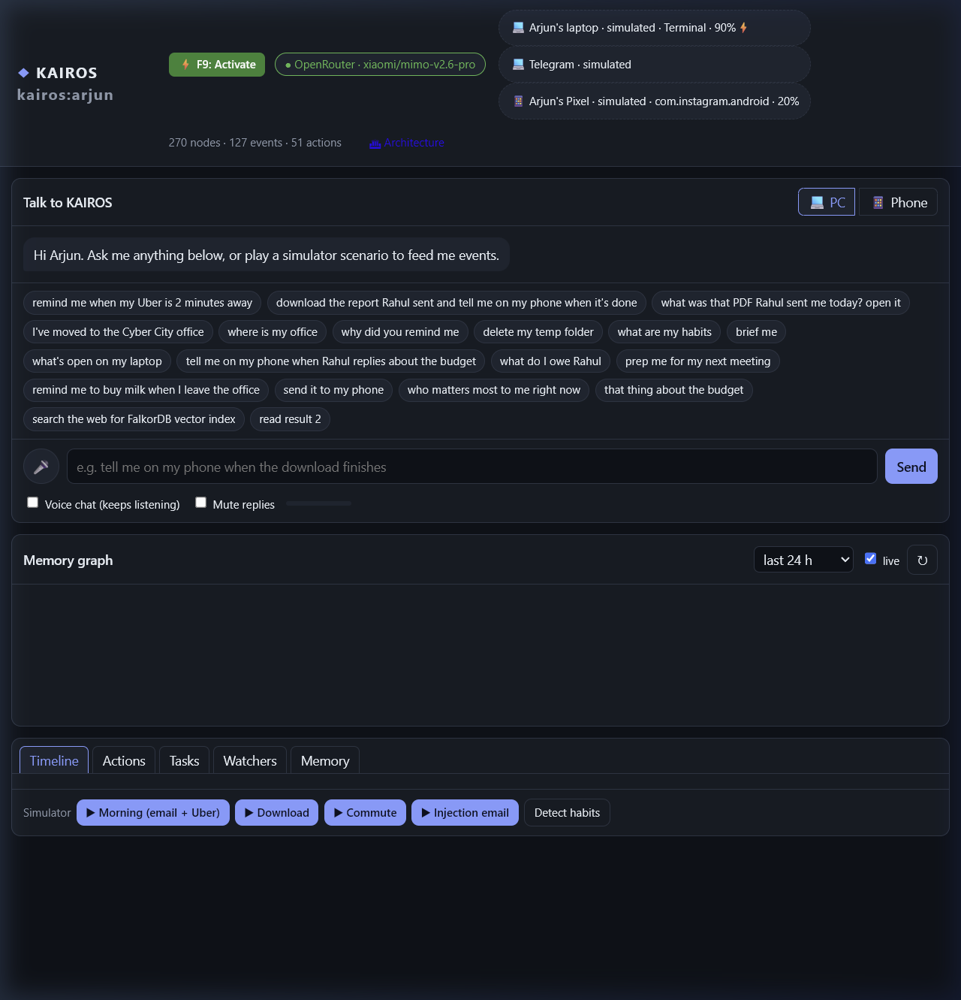
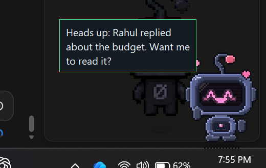
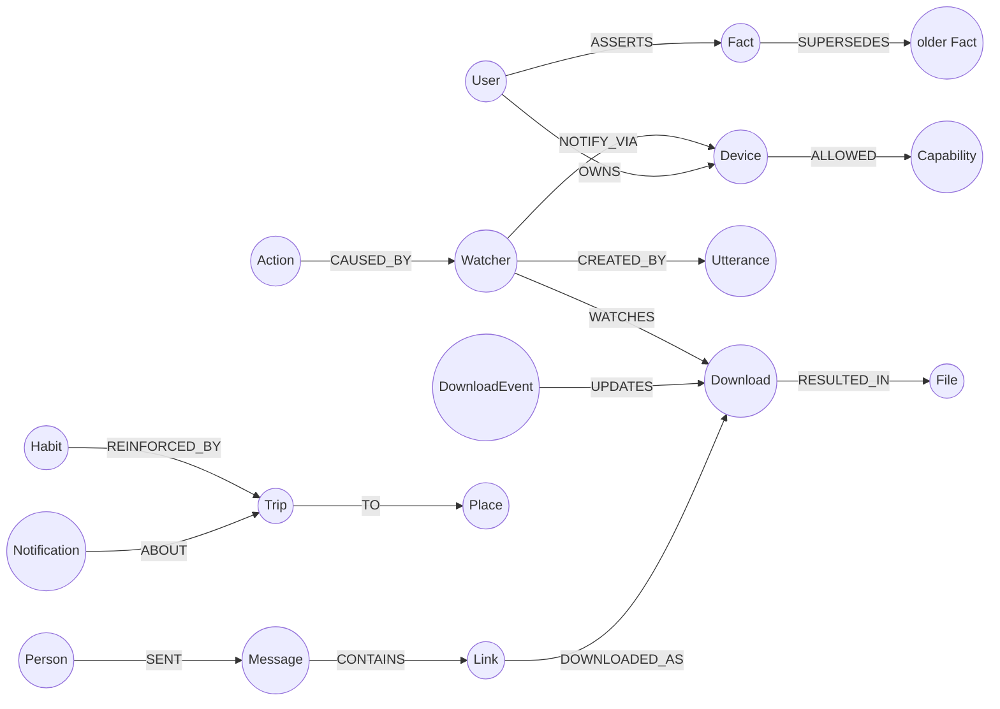

# Callisto (KAIROS)

[](https://www.python.org/)
[](https://www.falkordb.com/)
[](https://fastapi.tiangolo.com/)
[](LICENSE)

> A voice-first, multi-device personal assistant whose shared episodic and temporal memory is an active FalkorDB knowledge graph.

Built for **Graph Hacks: Context for AI Agents** (WeMakeDevs × FalkorDB, Oct 2026).

---



---

## The Problem: Why Vector Stores Fail for Personal Agents

Traditional AI agents rely on stateless LLMs backed by flat vector embeddings (`RAG`). While vector similarity works well for static document retrieval, it fails fundamentally for personal assistants operating across multiple devices:

1. **No Temporal Awareness:** A vector database cannot distinguish *"the report Rahul sent yesterday before my meeting"* from *"a report sent by Rahul three weeks ago"*.
2. **Device Isolation:** Your phone receives an Uber arrival notification or an OTP, while your laptop finishes downloading a 2GB dataset. Vector chunks cannot link disjoint device event streams into a single causal chain.
3. **Loss of Entity Evolution:** When you move to a new apartment or change offices, vector stores accumulate contradicting chunks. A graph can explicitly mark facts as superseded (`(:Fact)-[:SUPERSEDES]->(:Fact)`) while preserving history.
4. **Unexplainable Actions:** When an assistant alerts you to leave for the airport, a vector search cannot provide the deterministic reasoning chain that triggered that alert.

**Callisto** solves this by using **FalkorDB** as the central context and reasoning fabric. Every message, download, notification, active app, calendar event, and person is modeled as a connected node in a temporal graph.

---

## System Architecture

```
                     ┌──────────────────────────────────────────────┐
                     │          Android Phone (Termux / ADB)        │
                     │  • Notifications (Uber, WhatsApp, OTPs)     │
                     │  • Battery, connectivity & device status    │
                     └──────────────────────┬───────────────────────┘
                                            │ WebSocket / HTTP
                                            ▼
┌──────────────────────────────┐   ┌─────────────────┐   ┌──────────────────────────────┐
│       Windows PC Agent       │──▶│   FastAPI Hub   │◀──│      Desktop Avatar Pet      │
│ • Downloads watcher (NTFS)   │WS │ (Port 8000 / 80)│   │ • Transparent Tkinter sprite │
│ • Active window tracking     │   │ • WebSocket bus │   │ • Push-to-talk mic streaming │
│ • Sandboxed shell execution  │   │ • Event router  │   │ • Windows TTS & F9 hotkey    │
└──────────────────────────────┘   └────────┬────────┘   └──────────────────────────────┘
                                            │
                      ┌─────────────────────┴─────────────────────┐
                      ▼                                           ▼
          ┌───────────────────────┐                   ┌───────────────────────┐
          │     FalkorDB Graph    │                   │      Dual Brain       │
          │ • Episodic memory     │                   │ • Tool-calling LLM    │
          │ • Entity relationships│                   │   (OpenRouter)        │
          │ • Habit reinforcement │                   │ • Deterministic rule  │
          │ • Watchers & alerts   │                   │   planner fallback    │
          └───────────────────────┘                   └───────────────────────┘
```

---

## Core Components

### 1. Central Hub & Event Router (`kairos/hub/`)
- High-concurrency **FastAPI + WebSocket** server acting as the communication backbone.
- Real-time event streaming pipeline: device status, notifications, download hooks, and user utterances.
- Interactive web dashboard providing live memory graph visualization, event timelines, pending actions, and system metrics.

### 2. Temporal Graph Memory (`kairos/graph/`, `kairos/memory.py`)
- Powered by **FalkorDB** with over 120 specialized Cypher queries.
- **5-Hop Associative Retrieval:** Resolves natural queries like *"Open that spreadsheet Rahul mentioned"* by traversing:
  ```cypher
  MATCH (p:Person {name: $person})-[:SENT]->(m:Message)-[:CONTAINS]->(l:Link)
        -[:DOWNLOADED_AS]->(dl:Download)-[:RESULTED_IN]->(f:File)
  RETURN f.path, f.filename, dl.status
  ```
- **Habit Detection & Decay:** Analyzes temporal patterns (e.g., commute departure times, preferred cab providers) using graph reinforcement algorithms.
- **Entity State Watchers:** Enables background triggers like *"Tell me when the download finishes, then notify my phone"*.

### 3. Windows PC Companion Agent (`agents/pc_agent.py`)
- Native Windows background worker connected via persistent WebSocket.
- **Downloads Watcher:** Detects in-progress browser downloads and inspects Windows NTFS `Zone.Identifier` alternate data streams to link local files back to their originating web URLs.
- **Window Telemetry:** Polls active foreground application names and titles via `ctypes` without installing external drivers.
- **Action Executor:** Executes authorized, policy-checked shell commands, file opens, and Windows 11 toast notifications.

### 4. Interactive Desktop Pet (`kairos/pet/`)
- A zero-dependency transparent Tkinter companion that sits directly above your Windows taskbar.
- Supports customizable retro sprite skins with emotional state animations (idle, thinking, listening, happy, alert).
- **Voice & Speech:** Built-in push-to-talk streaming audio to the hub's `faster-whisper` speech-to-text engine and local text-to-speech feedback.
- **Global Summon Hotkey:** Press `F9` or `Ctrl+Shift+K` from any active application to summon Callisto.



### 5. Dual-Engine Reasoning Brain (`kairos/agent/`)
- **LLM Agent Loop:** Uses tool-calling LLMs (via OpenRouter) with dynamic GraphRAG prompt context.
- **Deterministic Offline Fallback:** If internet access drops or API timeouts occur, a zero-latency rule-based planner immediately handles device controls, queries, and routine tasks.

---

## Data Model



---

## Getting Started

### Prerequisites
- Python 3.10 or higher
- A FalkorDB instance (local Docker container or [FalkorDB Cloud](https://falkordb.com/))
- *(Optional)* OpenRouter API key for LLM-powered tool calling

### 1. Installation

```bash
git clone https://github.com/swz905/Callisto.git
cd Callisto

# Create virtual environment
python -m venv .venv
# On Windows:
.venv\Scripts\activate
# On Linux / macOS:
source .venv/bin/activate

# Install package and dependencies
pip install -e ".[voice,embeddings,mcp,web]"
```

### 2. Configuration

Copy the example environment file:
```bash
cp .env.example .env
```

Configure your credentials in `.env`:
```ini
KAIROS_USER=arjun
KAIROS_TZ=Asia/Kolkata

# FalkorDB Connection
FALKORDB_HOST=localhost
FALKORDB_PORT=6379
FALKORDB_PASSWORD=
FALKORDB_SSL=0

# LLM (OpenRouter)
KAIROS_LLM=auto
OPENROUTER_API_KEY=your_key_here
OPENROUTER_MODEL=xiaomi/mimo-v2.6-pro

# Hub URLs
KAIROS_HUB_URL=ws://localhost:8000
KAIROS_HUB_PUBLIC_URL=http://localhost:8000
```

### 3. Verify System Health

Run the diagnostic suite to validate database connectivity, Cypher dialect compatibility, and dependencies:
```bash
kairos doctor
```

Initialize graph schema, seed persona entities, and run synthetic habit consolidation:
```bash
kairos setup --weeks 3
```

---

## Running the Ecosystem

### Start the Hub Server
```bash
kairos hub --port 8000
```
Open your browser to `http://localhost:8000` to access the live dashboard, graph visualizer, and chat interface.

### Start the Windows PC Agent
In a separate terminal on your desktop:
```bash
python -m agents.pc_agent --hub ws://localhost:8000 --device pc-main
```
*(Or double-click `launch_pc_agent.bat`)*

### Start the Desktop Avatar Pet
```bash
kairos pet --hub http://localhost:8000 --device pc-main
```
*(Or double-click `launch_pet.bat`)*

### Terminal Chat Mode
Interact directly from your terminal:
```bash
kairos chat --device pc-main
```

---

## Production Deployment (Oracle Cloud / VPS)

Callisto can run 24/7 on an Ubuntu VPS (e.g., Oracle Cloud Always-Free ARM A1 instance):

1. **Systemd Service** (`/etc/systemd/system/kairos.service`):
   ```ini
   [Unit]
   Description=Callisto KAIROS Hub (FastAPI + Uvicorn)
   After=network.target

   [Service]
   User=ubuntu
   WorkingDirectory=/home/ubuntu/kairos
   EnvironmentFile=/home/ubuntu/kairos/.env
   ExecStart=/home/ubuntu/kairos/.venv/bin/python -m uvicorn kairos.hub.app:app --host 0.0.0.0 --port 8000
   Restart=always
   RestartSec=5

   [Install]
   WantedBy=multi-user.target
   ```

2. **Nginx Reverse Proxy** with WebSocket upgrade support:
   ```nginx
   server {
       listen 80;
       server_name _;

       location / {
           proxy_pass http://127.0.0.1:8000;
           proxy_http_version 1.1;
           proxy_set_header Upgrade $http_upgrade;
           proxy_set_header Connection "upgrade";
           proxy_set_header Host $host;
           proxy_set_header X-Real-IP $remote_addr;
           proxy_read_timeout 300s;
       }
   }
   ```

3. **Desktop Shortcut:**
   Use the included `start_kairos.bat` to launch both the PC Agent and the Desktop Pet connected directly to your cloud hub URL.

---

## Repository Structure

```
Callisto/
├── agents/                      # Device agent implementations
│   ├── pc_agent.py              # Windows companion (downloads, shell, toasts)
│   ├── pc_status.py             # Foreground window & battery telemetry
│   ├── phone_agent.py           # Android Termux / ADB notification watcher
│   └── browser_history.py       # Local browser history scanner
├── kairos/                      # Core hub & engine package
│   ├── hub/                     # FastAPI hub, WebSockets, and dashboard
│   │   ├── app.py               # Main application and REST endpoints
│   │   └── static/              # Dashboard UI, graph visualizer & assets
│   ├── agent/                   # LLM orchestration & tool calling
│   │   ├── core.py              # Main Agent loop & circuit breaker
│   │   ├── tools.py             # 40+ callable agent tools
│   │   ├── openrouter.py        # OpenRouter API client
│   │   └── intents.py           # Offline intent classification
│   ├── pet/                     # Desktop pixel avatar overlay
│   │   ├── app.py               # Tkinter transparent overlay
│   │   ├── sprite.py            # Pixel sprite sheets & skins
│   │   └── brain.py             # Pet speech bubbles & interaction logic
│   ├── voice/                   # Audio & Speech modules
│   │   ├── stt.py               # Faster-Whisper integration
│   │   └── wake.py              # OpenWakeWord detector
│   ├── graph/                   # FalkorDB client & Cypher schema
│   ├── channels/                # External messaging (Telegram, IMAP)
│   ├── doctor.py                # System diagnostics & query verification
│   └── cli.py                   # Unified CLI entrypoint
├── queries/                     # Standalone Cypher query definitions
├── sim/                         # Synthetic event simulator & scenarios
├── tests/                       # Complete automated test suite
├── start_kairos.bat             # 1-click desktop launcher
└── pyproject.toml               # Build configuration & dependencies
```

---

## License

This project is open-source and licensed under the [MIT License](LICENSE).
