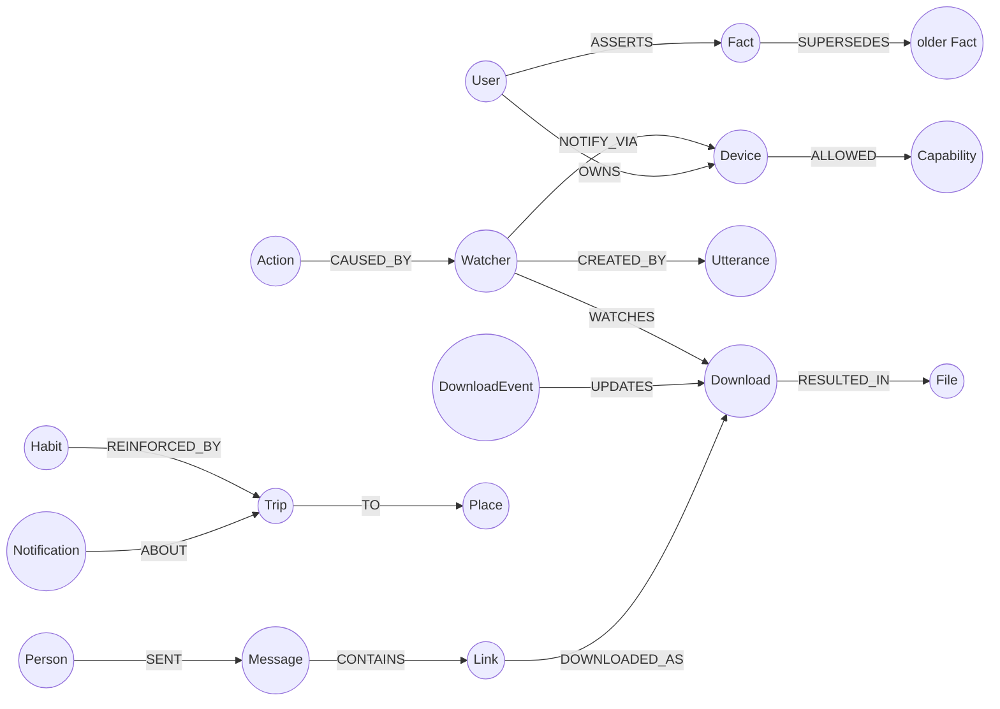

# Callisto (KAIROS)

[](https://www.python.org/)
[](https://www.falkordb.com/)
[](https://fastapi.tiangolo.com/)
[](LICENSE)

> **A proactive, cross-device AI companion spanning your phone and PC, with a temporal FalkorDB knowledge graph as its memory.**

---

## Overview

Modern AI assistants are typically isolated inside a single app, browser tab, or device, losing context as soon as you step away from your keyboard. 

**Callisto** bridges the gap between your **PC**, **Android phone**, and **messaging apps** into a unified intelligence layer. By using **FalkorDB** as an active, interconnected knowledge graph, Callisto remembers what you did, what files were shared, what commitments you made, and what routines you follow across all your devices.

```
       📱 Android Phone                 💻 Windows PC
       (Status, Alerts)               (Apps, Files, Shell)
              │                                │
              └───────────────┬────────────────┘
                              ▼
                     ⚡ FastAPI Hub Server
                              │
                    ┌─────────┴─────────┐
                    ▼                   ▼
           🧠 FalkorDB Graph     🤖 LLM Reasoning
           (Memory, Habits)     (OpenRouter / Local)
```

---

## Core Capabilities

### 🧠 Graph-Native Memory
- **Episodic & Temporal:** Captures events, app switches, file downloads, and notifications across devices in an interconnected graph.
- **Evolving Facts:** Remembers preferences, home/office locations, and relationships, automatically versioning and superseding facts without losing history.
- **Routines & Habits:** Automatically discovers repetitive user routines (e.g. daily commute times, cab providers, app usage patterns) through graph reinforcement and decay.

### 📱💻 Multi-Device Coordination
- **Cross-Device Handoff:** Share files, links, and synchronized clipboard content seamlessly between your PC and phone.
- **Real-Time Device State:** Continuously monitors device status (foreground app, battery level, active network) to resolve contextual requests (e.g., *"What was I working on?"* or *"Send this to my phone"*).

### 💬 Desktop & Web Chat Automation
- **Native Keystroke & Input Simulation:** Uses zero-dependency native Windows APIs to interact with messaging applications.
- **Automated Contact Search:** Automatically triggers contact search (`Ctrl + F`), locates the person or group in **WhatsApp** (Desktop/Web), **Telegram**, or **Slack**, and delivers the message.

### 🛡️ Zero-Trust Security & Policy Graph
- **Permission Graph:** Every capability (shell execution, file deletion, clipboard access) is governed by an explicit graph policy per device.
- **Prompt-Injection Defense:** Untrusted text from external emails, web pages, and notifications is tagged with trust levels, preventing malicious external content from triggering unauthorized actions.

### ⚡ Dual-Engine Brain
- **LLM Reasoning Loop:** Powered by modern tool-calling LLMs via OpenRouter with dynamic GraphRAG context injection.
- **Deterministic Offline Fallback:** Equipped with a built-in rule-based planner that guarantees instant, local responses even without internet connectivity.

---

## Knowledge Graph Model



---

## Quickstart

### Prerequisites
- Python 3.10+
- FalkorDB instance (Local Docker or FalkorDB Cloud)

### Setup

1. **Clone the repository:**
   ```bash
   git clone https://github.com/swz905/Callisto.git
   cd Callisto
   ```

2. **Create a virtual environment & install dependencies:**
   ```bash
   python -m venv .venv
   .venv\Scripts\activate      # On Linux/macOS: source .venv/bin/activate
   pip install -e .
   ```

3. **Configure environment:**
   Create a `.env` file from the template:
   ```env
   FALKORDB_HOST=localhost
   FALKORDB_PORT=6379
   OPENROUTER_API_KEY=your_key_here
   OPENROUTER_MODEL=xiaomi/mimo-v2.6-pro
   ```

---

## Project Status

This repository is currently being published in progressive stages. Core modules including graph schemas, multi-device agent daemons, and reasoning pipelines will be pushed incrementally.

---

## License

This project is licensed under the [MIT License](LICENSE).
