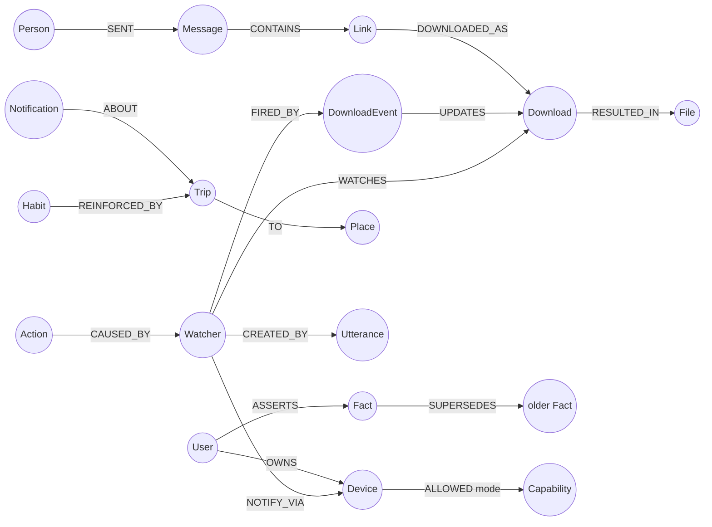

# KAIROS
**A voice-first personal agent that spans your phone and PC, with a FalkorDB graph as its memory.**
Graph Hacks: Context for AI Agents (WeMakeDevs × FalkorDB) · Track 02 (Agent Memory & Coordination), Track 01 (Agents That Act on Connected Data)

> "Tell me on my phone when the download finishes." "Remind me when my Uber is 2 minutes away." "What was that PDF Rahul sent me yesterday? Open it." "Why did you remind me?"

KAIROS watches notifications, downloads, files and commands on both devices and writes everything into one temporal knowledge graph. Recall, "tell me when…" watchers, habits, permissions and explanations are all graph queries. **Remove FalkorDB and none of them work.**

- Full design: [GraphHacks_Jarvis_Technical_Design.md](GraphHacks_Jarvis_Technical_Design.md)
- **What's implemented (full documentation):** [docs/IMPLEMENTATION.md](docs/IMPLEMENTATION.md)
- Build plan and status: [docs/PLAN.md](docs/PLAN.md)
- Every Cypher query the product uses: [queries/](queries/)

## Quick start
```bash
docker compose up -d falkordb          # FalkorDB + Browser at http://localhost:3000
python -m venv .venv && .venv\Scripts\activate
pip install -e .[dev,pc]
copy .env.example .env
kairos doctor --llm                    # readiness: packages, .env, FalkorDB, every Cypher query, seeding
kairos setup --wipe                    # schema, persona, 3 weeks of synthetic history, habits
kairos hub                             # hub + web dashboard → http://localhost:8000/
kairos chat                            # or: talk in the terminal; `/replay morning` plays a live scenario
```

### Web dashboard (`kairos hub` → http://localhost:8000/)
- **Chat** as the PC or the phone, with one-click demo commands and Yes/No buttons for risky actions.
- **Live memory graph** (no external libraries, works offline): drag, zoom, click a node to see its connections.
- **Timeline** of device events, the **action log** with *Why?* (the explanation path) and *Approve/Deny* for pending actions, **watchers** (cancel), and **memory** (versioned facts, habit strength, people).
- **Alert toasts** for everything sent to the phone or PC, plus simulator buttons (morning scenario, download, detect habits).
- Devices that aren't connected are simulated (`KAIROS_SIMULATE_DEVICES=1`), so the whole demo runs with no hardware.

### LLM: OpenRouter, with an offline rule-based backup
Put your key and model in `.env`:
```
OPENROUTER_API_KEY=sk-or-...
OPENROUTER_MODEL=<model id from openrouter.ai/models that supports tools>
```
Then check the setup:
```bash
kairos llm-check
```
`KAIROS_LLM=auto` (the default) uses OpenRouter when it's reachable. With no internet, no key, or an API error, the turn falls back to the rule-based planner, and a circuit breaker keeps later turns fast. Yes/no confirmations are always handled by rules, never by the model. The dashboard badge shows which planner is active.
Try in `kairos chat`:
```
remind me when my Uber is 2 minutes away
/replay morning
download the report Rahul sent and tell me on my phone when it's done
what was that PDF Rahul sent me today? open it
I've moved to the Cyber City office
why did you remind me
delete my temp folder        → asks first; answer "yes"
what are my habits
```

### Real devices
```bash
kairos hub                                                            # hub on :8000
python -m agents.pc_agent --hub ws://localhost:8000 --device pc-main --chat
# phone, in Termux (copy agents/common.py + agents/phone_agent.py):
python phone_agent.py --hub ws://<pc-ip>:8000 --device phone-arjun
# or from the PC over ADB:
python -m agents.phone_agent --adb --hub ws://localhost:8000
python -m kairos.voice.ptt --hub http://localhost:8000               # hold F9 to talk
kairos pet                                                           # desktop pet: click it to talk
```

## Graph data model

- **Episodic:** immutable `Event`s (Notification, DownloadEvent, FileEvent, BrowserVisit, CommandRun, Utterance), chained per device with `NEXT`.
- **Semantic:** Person, Place, File, Link, Message, Trip, Download, versioned `Fact`s (`valid_from` / `valid_to` + `SUPERSEDES`).
- **Procedural:** `Habit` (strength reinforced and decayed), `Watcher`.
- **Policy and audit:** `Capability` with risk tiers, `ALLOWED {mode}` per device, and an `Action` for every tool call, with `CAUSED_BY` edges for explanations.
- One graph per user (`kairos:<user>`), using FalkorDB multigraph.

## What breaks without FalkorDB
| Feature | Graph query |
|---|---|
| Cross-device recall | `recall_file_from_person`: Person→Message→Link→Download→File |
| "Tell me when…" | `match_entity_state`, `match_trip_eta`, … run on every event |
| Evolving memory | `assert_fact` (supersede, history kept) |
| Habits | `detect_trip_habits`, `decay_habits` |
| Safety | `check_permission` (missing edge = deny; tier 3 always confirms) |
| "Why?" | `explain_action`: the Action's `CAUSED_BY`/`FIRED_BY`/`CREATED_BY` path |

## Notification triage
Every live notification is judged against your open requests and context from the graph. The model (or rules, when offline) returns:
- **importance** from 0 to 3,
- whether it **fulfills an open-ended request** like "tell me when Rahul replies about the budget".

The matching watcher then fires, or you get an alert if the notification is urgent. Promotions are recorded but stay quiet. See [docs/IMPLEMENTATION.md §7b](docs/IMPLEMENTATION.md).

## Live device status
Every 2 minutes each device sends a snapshot:
- **PC:** the foreground app and window, open apps, battery, Wi-Fi, idle time and RAM. It uses Windows' own APIs, so nothing needs installing.
- **Phone:** battery and Wi-Fi, plus the foreground app over ADB.

The graph keeps the current state (`(Device)-[:RUNNING]->(App)`) and records only changes as events (app opened, closed or switched, battery low, network changed). The agent sees every device's live status on each turn, so it can answer "what's open on my laptop?" or "is my phone charging?" right away. See [docs/IMPLEMENTATION.md §7c](docs/IMPLEMENTATION.md).

## More of what it does
- **Safe by graph:** text from emails, messages, web pages or plugins is tracked as *untrusted*. If the LLM read any of it this turn, risky actions always ask first, and "why?" shows which content influenced it.
- **Commitments:** "Could you share the deck by Friday?" becomes a task linked to the sender, with a due reminder. "I've sent it" closes it.
- **Hybrid memory:** graph + free-text notes + full-text + vector search; a memory editor (edit, forget, merge duplicate people) and Markdown export.
- **Calendar (ICS) + meeting prep** spoken 15 minutes before, **email (IMAP)**, **Telegram**, **browser history**, **location watchers** ("remind me when I leave the office").
- **Talk to it:** the dashboard's 🎤 (or Ctrl+M) and *Voice chat* mode give a hands-free spoken conversation. Speech-to-text runs locally on the hub (faster-whisper). `kairos pet` puts a little pixel robot above your taskbar: it shows alerts as speech bubbles, says **NULL** when the hub is down, and you click it to talk.
- **Remembers across sessions:** each day's chat is saved to a text log on disk, and each night a small model files what you said in passing ("I'm flying to Goa next Friday") into the graph as facts, notes, people and tasks, linked back to that day. After a restart the conversation picks up where it left off. Ask "what did we talk about yesterday?".
- **Read-only web:** searches and reads pages with a real browser (or plain HTTP), remembers what it read, refuses local addresses, and asks before opening links nobody gave it.
- **File and clipboard handoff** between phone and PC, **MCP plugins**, **who matters most right now** (PageRank), **shared family memory**, **wake word**.

Details: [docs/IMPLEMENTATION.md §7d](docs/IMPLEMENTATION.md).

## How the agent thinks
- **OpenRouter planner** ([kairos/agent/llm.py](kairos/agent/llm.py)): a tool-calling loop (up to 6 steps). Each turn the model gets a GraphRAG *context card* built from the graph: devices, people, current facts, active watchers, routines, recent events, and the last file or link mentioned.
- **Every tool call goes through the permission graph and the action log**, whichever planner chose it. Device names like "phone" or "pc" are mapped to device IDs, and arguments the model invents are dropped.
- **Rule-based planner** ([kairos/agent/intents.py](kairos/agent/intents.py)): the offline backup that covers every demo command.
- **Extractor:** rules handle known apps (free, instant). The LLM only reads notifications from apps the rules don't recognize.

## Data
Demos use a synthetic persona ("Arjun Mehta", [sim/persona.yaml](sim/persona.yaml)). No real personal data is in the graph.

## AI assistance disclosure
Parts of this repository were written with the help of an AI coding assistant (Claude Code).
