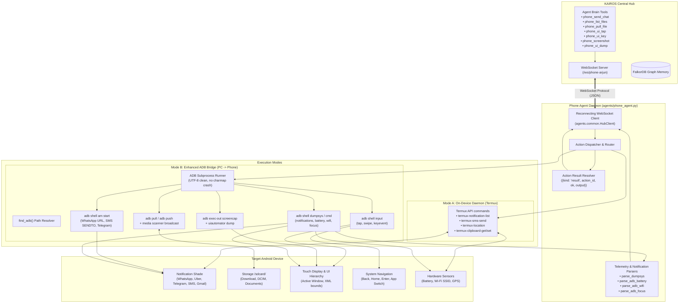

# KAIROS Phone Agent: Setup & Launch Guide

This guide walks you through launching and controlling your Android phone using **KAIROS Phone Agent**.



---

## Method 1: PC Bridge via ADB (Recommended — Maximum Control)

This method requires **zero installations on your phone** and gives maximum control:
- Reads notifications via system dumpsys
- Pulls and pushes files anywhere in `/sdcard/` (Downloads, DCIM, Documents)
- Sends WhatsApp messages, SMS, and Telegram chats
- Drives the UI (clicks, keystrokes, screenshots, UI dump)

### Step 1: Enable Wireless Debugging on your Phone
1. Go to **Settings > About Phone** and tap **Build Number** 7 times to enable Developer Options.
2. Go to **Settings > System > Developer Options**.
3. Turn ON **USB Debugging** and **Wireless Debugging**.
4. Tap **Wireless Debugging** to see your phone's **IP address and Port** (e.g., `192.168.1.50:5555`).

*(Alternatively, you can just plug your phone into your PC with a USB cable and accept the debugging prompt on your phone screen.)*

### Step 2: Ensure ADB is Installed on your PC
If you don't have ADB installed, run in PowerShell:
```powershell
winget install Google.PlatformTools
```
Or use the automated batch script in `scripts/launch_phone_adb.bat`.

### Step 3: Connect your Phone
If using Wireless ADB:
```powershell
adb connect <PHONE_IP>:<PORT>
```
Verify the device is connected:
```powershell
adb devices
```
*(You should see `<IP>:<PORT>    device`)*

### Step 4: Launch Phone Agent
Make sure your KAIROS Hub is running (`kairos hub` on port 8000), then launch:

**Option A (Using the automated launcher):**
Double-click:
```cmd
scripts\launch_phone_adb.bat
```

**Option B (From terminal):**
```powershell
python -m agents.phone_agent --hub ws://localhost:8000 --device phone-arjun --adb --chat
```

---

## Method 2: On-Device Daemon via Termux

This method runs directly on your phone, independent of your PC.

### Step 1: Install Termux & Termux:API
1. Install **Termux** from [F-Droid](https://f-droid.org/packages/com.termux/) or GitHub (do not use Google Play Store version as it is outdated).
2. Install **Termux:API** from [F-Droid](https://f-droid.org/packages/com.termux.api/).
3. In Android Settings, grant **Termux:API**:
   - Notification Access
   - SMS Permission
   - Location Permission (if using place watchers)

### Step 2: Setup Termux Environment
Open Termux and run:
```bash
pkg update -y
pkg install -y python termux-api git
pip install websockets
```

### Step 3: Run the Agent
Copy `agents/phone_agent.py` and `agents/common.py` to a directory on your phone:
```bash
python phone_agent.py --hub ws://<YOUR_PC_IP>:8000 --device phone-arjun --chat --location
```
*(Replace `<YOUR_PC_IP>` with your PC's local Wi-Fi IP address, e.g. `192.168.1.100`)*

---

## How to Interact & Test Phone Capabilities

Once the Phone Agent is connected to the Hub, you can control it via the KAIROS Hub Dashboard (`http://localhost:8000`), the interactive chat prompt, or through the new tools:

### 1. Notifications
Incoming notifications from WhatsApp, Uber, Gmail, etc., are automatically captured and streamed to KAIROS:
- Triggers priority scoring in `triage.py`.
- Fulfills active watchers (e.g., *"Tell me when my Uber arrives"* or *"Tell me when Rahul texts"*).

### 2. Send Chats (WhatsApp / SMS / Telegram)
Ask KAIROS in chat or run directly:
- **WhatsApp:**
  - Phone Agent launches WhatsApp with the recipient's number and message encoded in the intent:
    `phone_send_chat(recipient="+919876543210", message="Hey! Running 10 mins late", channel="whatsapp")`
- **SMS:**
  - `phone_send_chat(recipient="+919876543210", message="Test SMS", channel="sms")`

### 3. File Operations
- **List Files:**
  - `phone_list_files(path="/sdcard/Download")`
- **Pull File to PC:**
  - `phone_pull_file(remote_path="/sdcard/Download/invoice.pdf")`
  - Saves directly into your PC's `sandbox/` directory.

### 4. UI Automation & Screen Control (ADB Mode)
- **Take Screenshot:**
  - `phone_screenshot()` -> Saves `phone_screenshot_<timestamp>.png` in sandbox.
- **Inspect Screen Elements:**
  - `phone_ui_dump()` -> Returns active screen text and button bounding boxes.
- **Tap Screen:**
  - `phone_ui_tap(x=500, y=1200)`
- **Press Hardware/Navigation Buttons:**
  - `phone_ui_key(key="home")`
  - `phone_ui_key(key="back")`
  - `phone_ui_key(key="enter")`
  - `phone_ui_key(key="app_switch")`

---

## 5. Code Files Changed for the Phone Agent

| File Path | Role | Summary of Changes |
|---|---|---|
| [`agents/phone_agent.py`](file:///d:/Downloads/GraphHacks_Kairos/GraphHacks_Kairos/agents/phone_agent.py) | Android Agent Daemon | Termux & ADB modes, UTF-8 fix in `sh()`, ADB auto-discovery (`find_adb`), parsers (`wifi`, `battery`, `focus`, `dumpsys`), messaging (`send_chat`), file transfer (`list_files`, `pull_file`, `push_file`), UI automation (`ui_tap`, `ui_key`, `ui_screenshot`, `ui_dump`), result dispatch, and `--backfill`. |
| [`kairos/agent/tools.py`](file:///d:/Downloads/GraphHacks_Kairos/GraphHacks_Kairos/kairos/agent/tools.py) | Brain Tools & Dispatcher | Registered 7 phone tools in `TOOL_SPECS` (`phone_send_chat`, `phone_list_files`, `phone_pull_file`, `phone_ui_tap`, `phone_ui_key`, `phone_screenshot`, `phone_ui_dump`), added summaries in `summarize()`, and implemented handler methods on `Toolbox`. |
| [`kairos/agent/intents.py`](file:///d:/Downloads/GraphHacks_Kairos/GraphHacks_Kairos/kairos/agent/intents.py) | Offline Intent Planner | Added offline intent matching regexes and handlers for phone queries and messaging commands. |
| [`kairos/status.py`](file:///d:/Downloads/GraphHacks_Kairos/GraphHacks_Kairos/kairos/status.py) | Device State Tracker | Added phone state diffing (`battery.low`, `network.changed`, `app.focused`) and state properties without desktop process dependencies. |
| [`kairos/triage.py`](file:///d:/Downloads/GraphHacks_Kairos/GraphHacks_Kairos/kairos/triage.py) | Notification Triage | Integrated phone notification parsing, priority scoring (0–3), and active watcher matching. |
| [`kairos/policy.py`](file:///d:/Downloads/GraphHacks_Kairos/GraphHacks_Kairos/kairos/policy.py) | Safety & Policy Engine | Enforces confirmation on high-risk phone capabilities (`phone.send_message`, `phone.delete_file`) and sandboxing rules. |
| [`sim/persona.yaml`](file:///d:/Downloads/GraphHacks_Kairos/GraphHacks_Kairos/sim/persona.yaml) | Persona & Device Config | Mapped phone capabilities (`link.open`, `file.open`, `file.transfer`, `shell.exec`, `read`) to `phone-arjun`. |
| [`scripts/launch_phone_adb.bat`](file:///d:/Downloads/GraphHacks_Kairos/GraphHacks_Kairos/scripts/launch_phone_adb.bat) | Windows Launcher | Automated batch launcher with ADB detection, Wi-Fi pairing/connection prompts, and interactive chat. |
| [`scripts/termux_setup.sh`](file:///d:/Downloads/GraphHacks_Kairos/GraphHacks_Kairos/scripts/termux_setup.sh) | Termux Setup Script | Automated setup shell script for on-device Termux execution. |
| [`tests/test_status.py`](file:///d:/Downloads/GraphHacks_Kairos/GraphHacks_Kairos/tests/test_status.py) | Status & Parser Tests | Unit tests validating `parse_adb_battery`, `parse_adb_focus`, and `parse_adb_wifi`. |
| [`tests/test_models_sim.py`](file:///d:/Downloads/GraphHacks_Kairos/GraphHacks_Kairos/tests/test_models_sim.py) | Notification Tests | Unit tests validating `parse_dumpsys` against Android notification output. |

---

## 6. Phone Agent Tools Reference

| Tool Name | Capability & Risk | Arguments | What it Does |
|---|---|---|---|
| `phone_send_chat` | `link.open` (Risk 3 — Confirmation required) | `recipient`, `message`, `channel="whatsapp"` (`whatsapp` \| `sms` \| `telegram`), `device` | Dispatches chat via WhatsApp deep link + auto enter, SMS intent, or Telegram. |
| `phone_list_files` | `file.open` (Risk 1) | `path="/sdcard/Download"`, `device` | Lists files and directories on phone storage. |
| `phone_pull_file` | `file.transfer` (Risk 2/3) | `remote_path`, `local_dest=None`, `device` | Pulls file from phone storage into PC sandbox (`kairos_sandbox/`). |
| `phone_ui_tap` | `shell.exec` (Risk 2/3) | `x`, `y`, `device` | Simulates touchscreen tap at pixel coordinates via ADB. |
| `phone_ui_key` | `shell.exec` (Risk 2/3) | `key` (`home`, `back`, `enter`, `app_switch`, `power`, etc.), `device` | Sends key event to phone via ADB. |
| `phone_screenshot` | `file.open` (Risk 1) | `device` | Takes high-resolution screenshot and saves PNG in PC sandbox. |
| `phone_ui_dump` | `read` (Risk 1) | `device` | Dumps and inspects foreground UI element text and hierarchy via `uiautomator`. |


